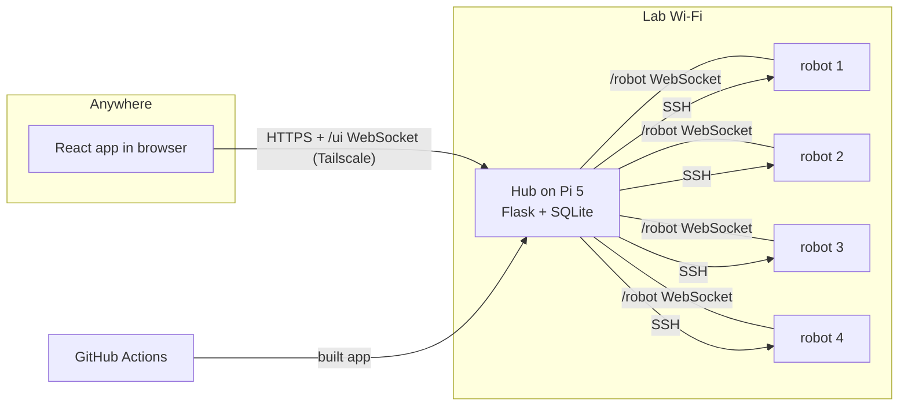

# Swarm Hub architecture

How the control app for the swarm is built: what runs where, how the parts talk, and the order we build it in.
Read `README.md` first for the project goals. The screens themselves are described in
[`docs/UI_SPEC.md`](docs/UI_SPEC.md) (for the designer).

Status: **approved design, 2026-11-08.** Step S0 is done. Everything else below is the plan.

**New to a word here (Tailscale, WebSocket, SQLite, CI...)?** Every tool and term is explained in plain
words in [section 13, Glossary](#13-glossary). Start with [Tailscale in one minute](#tailscale-in-one-minute).

---

## 1. What we are building

One app the whole team opens from anywhere (lab, home, campus) to see and control our robots (at most 4).
You open it, sign in, and the robots are there: status, sensors, camera, drive, arm, terminal, and a history
that survives restarts.

The app is a **React front end on top of the existing hub**. The hub keeps doing what it already does well
(robot link, SSH install, safety); we add a live connection for the app, a history database and a new UI.

### Decisions

| Topic | Decision | Why |
|---|---|---|
| Shape | Option 1: extend the current Flask hub, new React front end | Least risk; keeps the tested install and safety code |
| Hub machine | One **shared hub on a Raspberry Pi 5** in the lab, always on | Everyone sees the same robots and the same history |
| Dev hubs | Each teammate can still run a local hub + simulated robots for coding | Work without the lab or real hardware |
| Lab network | One Wi-Fi network (our own router) for the hub Pi and all robots, fixed addresses | Hotspot per robot can't run 4 robots at once; campus Wi-Fi often blocks device-to-device traffic |
| Remote access | **Tailscale** on the hub Pi and on teammates' laptops only. Robots don't need it | Works from anywhere, no ports opened, free for a team our size |
| HTTPS | `tailscale serve` in front of the hub | Real certificate, inside our private network only |
| Real-time | New `/ui` WebSocket (browser ↔ hub). Camera stays MJPEG | Replaces 1 s polling and 10 POSTs a second |
| Storage | SQLite file in `data/` (Python's built-in `sqlite3`) | No new package, no server, fine for 4 robots |
| Auth | Current hub logins (one per teammate), session cookie + CSRF | Already built and tested. Tailscale is the outer lock |
| Who may do what | Everyone signed in can do everything; risky actions are logged and confirmed | Small trusted team; roles can come later |
| Control | **One person controls a robot at a time**; anyone can always press Stop | Two people steering one robot is dangerous |
| Robot tokens | **Each robot has its own token** | A stolen robot can't pose as another |
| Build | GitHub Actions builds the React app and runs checks on every push | The hub Pi stays pip-only; broken changes are caught before robots |
| Remote driving | **Only while someone is in the lab** with the robots (for now) | Nobody can see a robot from home; a person nearby can stop or catch it |
| Git workflow | **Branch + pull request + green CI** before merging to `main` | Several people edit; CI catches breakage before it reaches robots |
| Work split | Hardware (robot 1, then 2-4) and software (app for 4 robots) **in parallel** | Simulated robots stand in until real ones are ready |
| Budget | $0 a month. One-time: Pi 5 kit (about $80) and a router (about $20, if no spare) | |

---

## 2. System overview

```
 Teammate laptop (anywhere)                       Lab (one Wi-Fi network)
 ┌────────────────────────┐   Tailscale (encrypted) ┌───────────────────────────────────────┐
 │ Browser / installed app│ ── HTTPS (REST) ──────► │ Hub on Raspberry Pi 5 (systemd service)│
 │ React + TypeScript     │ ◄═ /ui WebSocket ═════► │  Flask: auth · REST API · /ui · MJPEG  │
 │                        │ ◄── MJPEG camera ────── │  control lock · rate limits            │
 └────────────────────────┘                         │  SQLite: history · sensor samples      │
                                                    │  data/: logins, keys, robot list       │
                                                    └───────┬──────────────────┬────────────┘
                                                            │ /robot WebSocket │ SSH (install,
                                                            │ (unchanged)      │ update, terminal)
                                          ┌─────────────┬───┴─────────┬────────┴────┐
                                       robot 1       robot 2       robot 3       robot 4
                                    (robot_agent.py on each Pi, unchanged)
```



**Rule that keeps this clean:** the browser never talks to a robot. Every command goes browser → hub → robot,
so the hub can check who is in control, rate-limit, log, and stop robots when a browser disappears.

---

## 3. Components

### On the hub (Python, `hub/`)

| Module | Status | Job |
|---|---|---|
| `__main__.py` | exists | Command line: `adduser`, `token`, `rotate`, run (`--headless` on the Pi) |
| `app.py` | exists | Builds the Flask app from the parts below |
| `auth.py` | exists, extend | Login, CSRF, password-guess blocking. **Add:** JSON session endpoints for the React app |
| `api.py` | exists, extend | REST API (section 6). **Added:** control checks. **Add:** stop all, history, health, samples |
| `robots.py` | exists | Live robot link at `/robot`, robot list. **Added:** per-robot token check |
| `control.py` | **added** | Control lock (one controller per robot, 15 s lease) and command rate limit (25/s, burst 10) |
| `deploy.py` | exists | SSH Add / Update / Remove / Terminal. **Added:** gives each robot its own token |
| `jobs.py` | exists | Background install jobs with steps |
| `storage.py` | exists | Private files in `data/`. **Added:** per-robot tokens, rotated by `rotate` |
| `ui_socket.py` | new | `/ui` WebSocket for the app: live robot list, events, jobs; takes drive/arm/stop commands |
| `history.py` | new | SQLite history: events and sensor samples, batched writes, retention |
| `health.py` | new | Hub Pi health: CPU temperature, load, memory, disk, uptime |
| `config.py` | exists | All limits and names in one place |

### In the browser (`web/`, React + TypeScript + Vite)

| Part | Job |
|---|---|
| `api/` | Typed REST client and `/ui` socket client (reconnects by itself), shared types (section 6) |
| `state/` | One store (Zustand) fed by the socket: robots, events, jobs, me |
| `screens/` | Sign in, Fleet, Robot, History, Health, Help (see `docs/UI_SPEC.md`) |
| `components/` | Status pill, robot card, drive pad, arm sliders, camera view, sensor readout, terminal, step list, Stop all, control badge, confirm dialog, help tip |
| `help/` | The plain-language explanation of every feature, shown in the app |

Styling: Tailwind CSS with Radix-based components (shadcn/ui), following the designer's layouts.

### On the robots (`robot/`)

**No change.** Same agent, same protocol. The only difference is that `config.json` now holds the robot's own
token, which Update writes.

### Infrastructure

| Part | Job |
|---|---|
| Lab router | One Wi-Fi network for the hub Pi and robots; fixed (reserved) address for each |
| Raspberry Pi 5 | Runs the hub as a systemd service (`infra/swarm-hub.service`), Raspberry Pi OS 64-bit, Python 3.11 |
| Tailscale | On the hub Pi and teammates' laptops. Access rules: team devices may reach only the hub (`infra/tailscale-acl.hujson`) |
| `tailscale serve` | HTTPS on `https://swarm-hub.<tailnet>.ts.net` → hub on `127.0.0.1:8000` |
| GitHub Actions | On every push: checks + simulated-robot test + React build; publishes the build for `swarm update` |
| `tools/sim_robot.py` | A simulated robot (fake wheels, arm, ultrasonic) that runs the real `robot_agent.py` |

---

## 4. Data flows

### Live status (robot → screen)
1. Robot sends `heartbeat {sensors}` every second (unchanged).
2. `robots.py` updates the robot's live record.
3. `ui_socket.py` pushes the robot list to every open app 4 times a second, only when something changed.
4. `history.py` keeps one sensor sample per sensor every 5 s and writes connect/disconnect events.

### Manual drive (key press → wheels)
1. The app sends `drive {robot, forward, strafe, rotate}` over `/ui` about 10 times a second while a key is held.
2. The hub checks: signed in → command rate → **control lock** (claim or renew). If someone else holds it,
   the app gets the plain error and shows who.
3. The hub forwards `drive` to the robot. The robot stops by itself if commands stop for 0.5 s (unchanged).
4. If the app's socket closes while its user controls a robot, the hub sends `stop` to that robot at once
   and releases control.

### Stop / Stop all
Always allowed for anyone signed in, never rate-limited, never blocked by the control lock. Logged with who
pressed it.

### Camera
The app shows `GET /api/robots/<name>/camera?fps=<n>` in an ``. The robot sends each frame to the
hub once; the hub skips frames for viewers who asked for a lower `fps` (remote viewers default to 5 fps to save
the lab's upload bandwidth). The camera turns off 4 s after the last viewer leaves (unchanged).

### Install / Update / Remove
Unchanged background jobs over SSH. The app gets each job's steps pushed over `/ui` instead of polling.
Start, finish and failure go into history.

### History
Events go into an in-memory queue; `history.py` writes them in one transaction every 2 s (fewer SD card writes).

---

## 5. Security

**Two locks:** Tailscale decides which devices can reach the hub at all; the hub login decides who you are.
The hub is **never** opened to the public internet (no port forwarding, no public tunnel).

| Threat | Defence |
|---|---|
| Old secrets in git history (`SW/`) | **Before going remote:** `python -m hub rotate`, then Update every robot |
| Stolen robot reveals the token | Each robot has its own token (done). The shared token is still accepted for robots not updated yet; that fallback is removed in step S6 |
| Stolen hub Pi | It holds the SSH key to every robot. Keep the lab locked; if lost, `rotate` and Update. Never back up `data/` to git or the cloud |
| Someone on the internet | Can't see the hub: only Tailscale devices can. Access rules allow team devices → hub only |
| Someone on the lab Wi-Fi | WPA2 password on the router; hub login; robots' link needs a valid token |
| Another website using your signed-in session | REST: CSRF header on every POST (exists). `/ui`: session cookie **and** an `Origin` check |
| Password guessing | Lockout after 5 wrong tries for 60 s (exists) |
| Terminal misuse | It's a shell on the robot. Confirm on first use per session; every command is logged (who, robot, command, exit code; **not** the output, which can contain secrets) |
| Command flooding | 25 drive/arm commands a second per person per robot (done) |
| Secrets in the browser | The app never receives tokens, keys or password hashes; robot passwords are used once and never stored (exists) |

---

## 6. API contracts

All JSON. Errors: an HTTP error code and `{"error": "plain sentence for students"}`. Every `/api` route needs a
signed-in session; every POST needs the `X-CSRF` header.

### Shared types (TypeScript, `web/src/api/types.ts`)

```ts
type RobotStatus = "connected" | "unresponsive" | "offline";

interface Capabilities {
  drive: boolean;
  camera: boolean;
  arm: Record<string, [number, number]>;   // joint -> [lowest, highest] pulse, µs; {} = no arm
  sensors: string[];                        // e.g. ["distance_cm"]
}

interface RobotRow {
  name: string;                 // "masterpi-01"
  hostname: string;             // the robot's own name
  status: RobotStatus;
  seen_ago: number | null;      // seconds
  latency_ms: number | null;    // from the last Ping
  event: string;                // last thing that happened, plain words
  address: string | null;
  installed: boolean;           // installed by this hub (can Update/Remove/Terminal)
  robot_type: string;           // "masterpi"
  capabilities: Capabilities | null;   // null = older agent that didn't say
  sensors: Record<string, number | null>;
  job: string | null;           // install step running now, if any
  controlled_by: string | null; // who has control right now
}

interface JobStep { text: string; state: "run" | "ok" | "fail" | "info" }
interface Job { action: "add" | "update" | "remove"; robot: string | null;
                state: "running" | "done" | "warning" | "failed"; message: string; steps: JobStep[] }

interface HistoryEvent {
  id: number; at: number;       // unix seconds
  robot: string | null; user: string | null;
  kind: string;                 // see "Event kinds"
  message: string;              // plain sentence
  data?: Record<string, unknown>;
}
```

### REST

| Method & path | Body | Returns | Status |
|---|---|---|---|
| `GET /auth/session` | | `{user: string \| null, csrf}` | new |
| `POST /auth/login` | `{username, password}` | `{user}` or 401/429 | new (JSON version of the form) |
| `POST /auth/logout` | | `{ok}` | new |
| `GET /api/robots` | | `RobotRow[]` | exists |
| `POST /api/robots` | `{host, user, password, name?, reboot?}` | `{job}` | exists |
| `GET /api/jobs/<id>` | | `Job` | exists |
| `POST /api/robots/<n>/update` | `{password?, reboot?}` | `{job}` / 409 busy | exists |
| `POST /api/robots/<n>/remove` | `{password?, forget?}` | `{job}` / 409 busy | exists |
| `POST /api/robots/<n>/exec` | `{command, cwd}` | `{output, code, cwd, timed_out, truncated, limit}` | exists |
| `GET /api/robots/<n>/camera?fps=` | | MJPEG stream | exists; `fps` new |
| `POST /api/robots/<n>/drive` | `{forward, strafe, rotate}` (-1..1) | `{ok}` / 409 control / 429 | exists, control added |
| `POST /api/robots/<n>/arm` | `{targets: {joint: µs}}` | `{ok}` / 409 / 429 | exists, control added |
| `POST /api/robots/<n>/arm_release` | | `{ok}` / 409 / 429 | exists, control added |
| `POST /api/robots/<n>/release_control` | | `{ok}` | **added** |
| `POST /api/robots/<n>/ping` | | `{ok}` | exists |
| `POST /api/robots/<n>/stop` | | `{ok}` | exists (never blocked) |
| `POST /api/stop_all` | | `{stopped: string[]}` | new |
| `GET /api/history?robot=&user=&kind=&before=&limit=` | | `{events: HistoryEvent[], next_before}` | new |
| `GET /api/robots/<n>/samples?sensor=&since=` | | `{points: [at, value][]}` | new |
| `GET /api/health` | | `{hub: {cpu_temp_c, load, mem_used_pct, disk_free_gb, uptime_s, version}, robots: [{name, latency_ms, reconnects_24h}]}` | new |

### `/ui` WebSocket (browser ↔ hub)

Opened at `wss://<hub>/ui`. The hub checks the session cookie and that `Origin` matches the hub's own address;
otherwise it closes the socket. Every client message may carry an `id`; the hub answers with `ack` or `error`
for that `id`.

| Direction | Message | Notes |
|---|---|---|
| hub → app | `hello {user, server_time}` | first message |
| hub → app | `robots {rows: RobotRow[]}` | up to 4 a second, only on change |
| hub → app | `event {event: HistoryEvent}` | live history line |
| hub → app | `job {id, job: Job}` | on every step change |
| hub → app | `ack {id}` / `error {id, error}` | answer to a client message |
| app → hub | `drive {robot, forward, strafe, rotate}` | control + rate checked |
| app → hub | `arm {robot, targets}` / `arm_release {robot}` | control + rate checked |
| app → hub | `stop {robot}` / `stop_all {}` | always allowed |
| app → hub | `take_control {robot}` / `release_control {robot}` | |
| app → hub | `ping {robot}` | |

When the socket closes, the hub stops every robot this user controls and releases control.

### `/robot` WebSocket (robot ↔ hub)

Unchanged (see `CLAUDE.md`, "Protocol"). The `hello` token is now the robot's own token.

### Event kinds

`hub.started`, `login.ok`, `login.failed`, `robot.connected`, `robot.disconnected`, `robot.silent`,
`robot.capabilities`, `robot.camera_error`, `control.taken`, `control.released`, `control.expired`,
`command.stop`, `command.stop_all`, `command.arm_release`, `terminal.run`, `install.started`, `install.done`,
`install.warning`, `install.failed` (same for `update.*`, `remove.*`).
Single drive and arm commands are **not** logged one by one (too many); a control session (taken → released)
is.

---

## 7. Data storage

| What | Where | Kept |
|---|---|---|
| Logins (password hashes), cookie key, shared token, SSH key | `data/` files (exists) | until `rotate` |
| Robot list incl. each robot's token | `data/robots.json` (exists) | until removed |
| Events | `data/history.sqlite`, table `events(id, at, robot, user, kind, message, data)` | 90 days |
| Sensor samples | same file, table `samples(at, robot, sensor, value)`, one per sensor per 5 s | 7 days |
| Live state (who's online, control, camera frames) | memory only | until restart |

SQLite runs in WAL mode; cleanup of old rows runs once an hour. If the SD card wears out we move `data/` to a
USB SSD. Back up only `history.sqlite` if you want a backup; never the secret files.

---

## 8. Failure handling

| What fails | What happens |
|---|---|
| Browser tab closes, laptop sleeps, home internet drops | Robot stops within 0.5 s (exists). With `/ui`, the hub also stops it at once and frees control |
| Lab Wi-Fi drops for a robot | Robot stops after 3 s of hub silence and reconnects by itself (exists). App shows *unresponsive*, then *offline* |
| Hub Pi crashes or reboots | Every robot stops within 3 s; systemd restarts the hub; robots reconnect by themselves; history is on disk |
| Two people try to drive one robot | The second gets "*alice is controlling masterpi-01 right now. You can still press Stop…*" (done) |
| Controller walks away | Control lapses 15 s after their last command (done) |
| Slow link (Tailscale relay) | App shows latency; drive still safe (dead-man). Camera drops frames instead of lagging (exists) |
| Robot code crashes | systemd restarts it (exists); Update shows its last log lines (exists) |
| Bad change pushed to GitHub | CI shows a red ✕; `swarm update` only fetches builds that passed |
| Tailscale down | Remote access stops; in the lab, open the hub by its LAN address |

---

## 9. Observability

- **History screen**: every event above, filterable by robot, person and kind.
- **Health screen**: hub CPU temperature (the Pi slows down when hot), load, memory, disk, uptime; per robot:
  latency and reconnects in the last 24 h.
- **Robot detail**: last event, capabilities, live sensors with a short chart from the samples.
- **Logs**: the hub prints to journald on the Pi (`journalctl -u swarm-hub`); robots print to
  `journalctl -u swarm-agent` (reachable from the Terminal).

---

## 10. Folder structure (target)

```
swarm-system/
├── ARCHITECTURE.md            this file
├── README.md / CLAUDE.md
├── hub/                       Python backend (Flask), runs on the hub Pi or a dev PC
│   ├── __main__.py app.py auth.py api.py robots.py deploy.py jobs.py storage.py config.py
│   ├── control.py             control lock + command rate          (added)
│   ├── ui_socket.py           /ui WebSocket for the app             (new)
│   ├── history.py             SQLite history + retention            (new)
│   ├── health.py              hub Pi health readings                (new)
│   ├── templates/ static/     current page (kept until the new app replaces it)
│   └── static/app/            built React app, fetched by `swarm update` (gitignored)
├── web/                       React + TypeScript + Vite source      (new)
│   ├── src/api/               client.ts, socket.ts, types.ts
│   ├── src/state/             store
│   ├── src/screens/           SignIn, Fleet, Robot, History, Health, Help
│   ├── src/components/        StatusPill, RobotCard, DrivePad, ArmPanel, CameraView, ...
│   └── src/help/              feature explanations shown in the app
├── robot/                     runs on each robot (unchanged)
├── tools/sim_robot.py         simulated robot for development       (new)
├── infra/                     swarm-hub.service, tailscale-acl.hujson, lab-network.md   (new)
├── .github/workflows/ci.yml   checks, simulated-robot test, web build                    (new)
├── docs/UI_SPEC.md            screens and features, for the designer
└── data/                      secrets + history (gitignored, never committed)
```

---

## 11. Build phases

Two tracks run **in parallel**: hardware finishes robot 1 and then builds robots 2-4; software builds the app
for 4 robots, using simulated robots until the real ones exist. Each step ends with something that works;
don't start the next step in a track until its "done when" is true.

### Track H: hardware (details and checklist in `docs/robots.md`)

| Step | Work | Done when |
|---|---|---|
| **H1. Finish robot 1 (Clanker)** | Run the hardware-finished checklist: wheel directions, dead-man test, arm safe limits per joint, ultrasonic, camera, power | Every Clanker line in the checklist is ✅ |
| **H2. Gyro + battery** | Wire both on Clanker; add them to `robot/sensors.py` (`setup`, `names`, `read`) | Heading and battery show in the Sensors column |
| **H3. Robots 2-4** | Build and wire like Clanker, Add robot, run the checklist | 4 robots ✅ |

### Track S: software

| Step | Work | Done when |
|---|---|---|
| **S0. Hardening** ✅ | Per-robot tokens; control lock; command rate limit | Done (tested with two simulated robots and two logins) |
| **S1. Rotate secrets** | Stop the hub, `python -m hub rotate`, start it, Update Clanker | Clanker reconnects with its own token |
| **S2. Sim robots + CI** | `tools/sim_robot.py` (run 4 at once); GitHub Actions: Python checks + sim test (tokens, control, rate, stop); protect `main` (PR + green CI) | Anyone runs hub + 4 sim robots on a laptop; a broken PR shows red |
| **S3. Backend for the app** | `history.py`, events wired in, `ui_socket.py`, stop on disconnect, stop all, session/history/health/samples endpoints, camera `fps` | The current page still works; `/ui` and the new endpoints pass the sim test |
| **S4. Shared hub Pi + lab network** | When the Pi 5 and router arrive: fixed addresses; hub as a systemd service; Tailscale on Pi + laptops; `tailscale serve`; access rules; re-add the robots from the Pi | A teammate at home opens the HTTPS address and sees Clanker (driving only with someone in the lab) |
| **S5. React app v1** | Screens from `docs/UI_SPEC.md` (designer works in parallel from now); built by CI; served by the hub at `/` (current page moves to `/classic`). Can start on the REST API after S2 and switch to `/ui` after S3 | The team uses the new app for a week without needing the old page |
| **S6. Clean-up** | Remove the old page, the shared-token fallback, `hub/server.py`; update README and CLAUDE.md | Nothing left that the new app doesn't need (do this last, with approval) |
| Later | Jobs (recipes), World map, AI planner, per README Phases 2-6 | |

### Where the tracks meet
- **New sensors** (H2): the app shows any sensor a robot reports, so hardware only touches `sensors.py`. Tell
  software the reading's name and unit (e.g. `heading_deg`, `battery_pct`) so it gets a nice label.
- **Arm limits** (H1): the robot reports them; the app's sliders follow automatically.
- **Before each app release**: a quick test on Clanker (drive, Stop, arm, camera), not only on sim robots.

---

## 12. Open items

1. **Repo public or private?** If private, the Pi needs a read-only GitHub token (a new secret in `data/`) to
   fetch builds; or we install Node on the Pi and build there.
2. Check the current Tailscale free-plan limits on tailscale.com/pricing before step S4 (reported in 2026:
   6 users, non-commercial use).
3. Ask IT whether we may plug our own router into the lab's wired internet.
4. Pi 5 needs its official 5 V / 5 A power supply and a good SD card (or USB SSD).
5. `rotate` while the hub is running: stop the hub first, or it keeps the old secrets in memory.
6. Step S4 changes the "each teammate runs their own hub" rule in README and CLAUDE.md to "shared hub for the
   robots, local hubs for development" (both already mention it as planned).

---

## 13. Glossary

Short explanations of everything this plan uses, and **why we use it**. When a doc adds a new tool or term,
add it here.

### Tailscale in one minute

**The problem.** Our hub sits in the lab. From home, your laptop can't reach it: routers (home, campus) block
connections coming in from the internet, and the hub has no public address. Opening ports on a router to fix
that would expose the hub to the whole internet, which we don't want.

**What Tailscale does.** It's a free app you install on each device you want to connect (here: the hub Pi
and each teammate's laptop). Each device signs in to the same Tailscale account (a "tailnet"). Tailscale then
builds an **encrypted private network** between just those devices, over whatever internet they're on. Each
device gets a fixed private address (like `100.101.102.103`) and a name (like `swarm-hub`) that work from
anywhere: lab, home, a café. Devices outside your tailnet can't see the hub at all.

**How it gets through routers.** Your devices each connect *out* to Tailscale's coordination servers (going
out is allowed almost everywhere), exchange keys, and then talk to each other directly. If a direct path is
impossible, traffic goes through a Tailscale relay ("DERP"), still encrypted end to end, just a bit slower.

**What we use from it.**
- **The private network** itself: open the hub from anywhere.
- **`tailscale serve`**: puts a real HTTPS address in front of the hub
  (`https://swarm-hub.<tailnet>.ts.net`), with a proper certificate, reachable only inside the tailnet.
- **Access rules (ACLs)**: a small file saying who may reach what. Ours: team laptops may reach only the hub.

**What it is not.** Not a public website host, not a cloud server, and it doesn't touch the robots (they stay
on the lab Wi-Fi with the hub). The free plan is enough for our team (check limits at tailscale.com/pricing).

**Try it:** install Tailscale on two of your own devices, sign in with the same account, and ping one from
the other by its 100.x address. That's the whole idea.

### Networking

| Term | What it is | Why we use it |
|---|---|---|
| LAN | Local network: the devices on one Wi-Fi or router | Hub Pi and robots share the lab LAN, so they talk fast and directly |
| Router | The box that makes the Wi-Fi network and hands out addresses | Our own router in the lab, because campus Wi-Fi often blocks device-to-device traffic |
| IP address | A device's address on a network, e.g. `192.168.1.20` | How the hub and robots find each other |
| Fixed (reserved) address | Telling the router "always give this robot the same address" (a DHCP reservation) | A robot's address doesn't change after a reboot |
| Hotspot | A device sharing its own Wi-Fi network | Not used: a laptop can join only one hotspot at a time |
| Port | A numbered "door" on a device for one program, e.g. `8000` for the hub | The hub listens on port 8000 |
| Port forwarding | Opening a router port to the internet | Deliberately **not** used: it would expose the hub publicly |
| HTTPS / certificate | An encrypted web connection; the certificate proves the site is really yours | `tailscale serve` gives the hub one for free |
| SSH | Secure remote login to a computer's command line | The hub installs and updates robot code over SSH |
| SSH key | A key file that lets a machine log in without a password | The hub's key lives in `data/`; every robot trusts it |

### Hub and robots

| Term | What it is | Why we use it |
|---|---|---|
| Hub | Our Python program that robots connect to and the app talks to | The single switchboard for every command |
| Agent | The program on each robot (`robot_agent.py`) | Connects to the hub, runs commands, sends sensor data |
| Raspberry Pi 5 | A small, cheap, low-power computer | Runs the shared hub 24/7 in the lab |
| Headless | Running with no screen or keyboard attached | The hub Pi sits in a corner; you use it through the app |
| systemd service | Linux's way to run a program in the background, start it on boot, and restart it if it crashes | Hub (`swarm-hub`) and agents (`swarm-agent`) run this way |
| journald / `journalctl` | Linux's log keeper / the command that reads it | Where hub and robot logs go |
| Token | A secret string a robot sends to prove it's allowed in | Each robot has its own, so one stolen robot can't pose as another |
| Rotate (secrets) | Replace all keys and tokens with new ones | The old ones leaked in git history |
| Dead-man switch | Stop automatically when the "keep going" signal stops | Wheels stop if drive commands stop for 0.5 s |
| Control lock / lease | Only one person controls a robot; their claim expires 15 s after their last command | Two people steering one robot is dangerous |
| Rate limit | A cap on how many commands per second get through | A stuck key or a script can't flood a robot |
| Simulated robot | A fake robot: the real agent with pretend wheels and sensors | Build and test the app for 4 robots before they exist |

### Web app

| Term | What it is | Why we use it |
|---|---|---|
| Front end / back end | The part in your browser / the part on the server | The React app (front) talks to the Flask hub (back) |
| Flask | A small Python web framework | The hub is already built on it |
| REST API | URLs the app calls to get data or do actions, e.g. `POST /api/robots/x/stop` | Simple requests like Add robot, history, health |
| JSON | A text format for data: `{"name": "Clanker"}` | Everything between app, hub and robots is JSON |
| WebSocket | A connection that stays open so both sides can send messages any time | Live status pushed instantly; drive commands without delay. `/robot` for robots, `/ui` for the app |
| Polling | Asking "anything new?" over and over | What the current page does every second; the WebSocket replaces it |
| MJPEG | Video sent as a stream of JPEG pictures | The simplest way to show a camera in a web page (an `` tag) |
| Hash route | The part of the address after `#` (`/#/robot/clanker/arm`), read by the page itself | One page shows Fleet or a robot without reloading, so driving and the camera aren't interrupted, and Back still works |
| SVG sprite | Many icons kept in one SVG file, each drawn with `<use href="#name">` | All the app's icons in one place (`hub/templates/icons.svg`), inlined so they still show when the hub can't be reached |
| React | A JavaScript library for building interactive pages from components | The new app |
| TypeScript | JavaScript with types, so mistakes show up while you type | Safer code when several people edit it |
| Vite | A tool that runs the app while you develop and builds the final files | Fast dev server; builds what the hub serves |
| Zustand | A tiny library that keeps the app's shared data (robots, events) in one place | Every screen reads the same live data |
| Tailwind CSS | Styling with small ready-made classes (`p-4`, `text-red-600`) | Quick to match the designer's layouts |
| Radix / shadcn/ui | Ready, accessible building blocks (dialogs, menus, sliders) copied into our code | No need to rebuild dialogs and sliders from scratch |
| Session cookie | A small signed note the browser keeps after you sign in | How the hub knows who you are on each request |
| CSRF | An attack where another website makes your browser send requests to ours | Blocked by a secret header on every POST (already built) |
| Origin check | Checking which website opened a WebSocket | Stops other sites from using your signed-in session on `/ui` |

### Data and build

| Term | What it is | Why we use it |
|---|---|---|
| SQLite | A database stored in one file, built into Python | History and sensor samples with no database server |
| WAL mode | An SQLite setting that lets reads and writes happen at the same time | The app can read history while the hub writes it |
| Retention | How long old data is kept before it's deleted | Sensor samples 7 days, events 90 days |
| Git branch | A separate line of work in the repo | Each feature on its own branch |
| Pull request (PR) | Asking to merge a branch into `main`, with review | Teammates see changes before they land |
| CI (continuous integration) | Automatic checks that run on every push | Catches broken code before it reaches robots |
| GitHub Actions | GitHub's free service that runs CI on its computers | Builds the React app and runs the checks |
| Branch protection | A GitHub setting: `main` only accepts PRs with green CI | Enforces our "green CI before merge" rule |
| Build | Turning source code (React/TypeScript) into the final files a browser runs | Done by GitHub Actions, so the Pi needs no Node |
